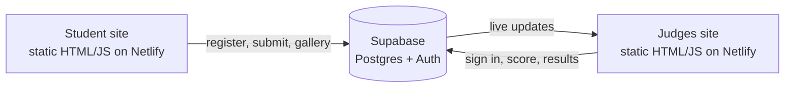

# booth hacks

Two connected websites for running **Booth Hacks**, the hackathon at the University of Chicago Booth School of Business: one for the **teams** who build, and one for the **judges** who score.

| Site | Who uses it | Live link |
| --- | --- | --- |
| [`student-site/`](student-site) | Participating teams | [boothhacks-student.netlify.app](https://boothhacks-student.netlify.app/) |
| [`judges-site/`](judges-site) | Judges and organizers | [boothacks-judges.netlify.app](https://boothacks-judges.netlify.app/) |

Both sites read from and write to the same database, so a project a team submits shows up on the judges' screens within seconds, with no copying, no spreadsheets and no lost scores.

---

## Why I made them

Running a hackathon judging day usually means a mix of Google Forms, shared spreadsheets and paper scorecards. That causes predictable problems: teams submit links in different places, judges score on different scales, scores get lost or typed in twice, and organizers spend the end of the event adding up numbers instead of announcing winners.

These sites were built to fix that, with a few principles:

- **Separate sites for separate audiences.** Students and judges never share a page. Teams see only what they need to submit. Judges and organizers sign in to their own site.
- **Every score is stored centrally the moment it's saved.** Results live in a database, not in a judge's browser or a spreadsheet, and organizers can download them at any time.
- **One rubric, applied the same way by everyone.** Judges rate each criterion 3 Strong, 2 Adequate or 1 Weak, with the rubric text written on the buttons. The site does all of the weighting and math.
- **Simple for non-technical people.** Organizers can change teams, prizes, criteria, weights and judge assignments from a web console, without editing code.

---

## The student site

Teams use it to take part in the event, without having to create an account.

1. **Register your team.** Enter a team name and 1–5 members. The site gives the team a private **team code**.
2. **Submit your project.** Pick the team, enter the code, the product name, the website link, the prizes the team is competing for and a short description. Teams can resubmit to update their entry at any time.
3. **Keep it confidential, if needed.** A checkbox keeps the project out of the public gallery. Judges and organizers still see it.
4. **Browse the project gallery.** See what other teams built, filtered by prize. Organizers can hide the gallery.

## The judges site

Judges sign in with an email and password created by the organizers.

- **Project list.** Every submitted project appears live, with filters for each prize and **My prizes**.
- **Scoresheet.** Each project has:
  - A **working demo** check, which is the table stakes for any prize.
  - The **five core criteria**: User, Problem & Value · Evidence & Opportunity · Product Judgment & MVP · Positioning & Adoption · Measurement & Viability.
  - **Prize Fit**, only for the prizes this judge is assigned to and the team entered.
  - Live totals: **every prize is out of 300**.
- **Organizer console**, visible to organizers only:
  - **Results:** a live leaderboard per prize, with flags for projects that have no working demo, plus CSV downloads of the leaderboard and of every individual score.
  - **Submissions, Teams & codes:** manage entries, open or close registration, show or hide the gallery.
  - **Prizes:** edit prizes and their Prize Fit rubrics, and **assign judges to each prize** (with a lead).
  - **Criteria:** edit the rubric text and the two sets of weights.
  - **Judges:** add judges and organizers.

### How scoring works

| Criterion | Best Overall | Category prizes |
| --- | :---: | :---: |
| User, Problem & Value | 25 | 15 |
| Evidence & Opportunity | 20 | 10 |
| Product Judgment & MVP | 25 | 20 |
| Positioning & Adoption | 20 | 15 |
| Measurement & Viability | 10 | 10 |
| Prize Fit | – | 30 |

Each 1–3 rating is multiplied by its weight and the results are added up, so every prize has a maximum score of 300.
- **Best Overall** averages every judge's scores, and every team is included.
- **Category prizes** average only the scores of the judges assigned to that prize.

---

## How it's built



- **Front end:** plain HTML, CSS and JavaScript, with no build step. Each site is a folder you can drag onto Netlify.
- **Back end:** [Supabase](https://supabase.com), which provides a Postgres database, judge logins (Supabase Auth) and live updates (Realtime).
- **Security:** row-level security rules in the database decide who can see what:
  - Students have no login. They can only call a few checked actions (register, submit with a valid team code, read the gallery), and they can't read other teams' codes or any scores.
  - Judges can read submissions but can only write their own scores.
  - Only organizers can see every score or change settings.

### Repository layout

```
student-site/      the teams' site (index.html, app.js, styles.css, config.js)
judges-site/       the judges' and organizers' site
supabase/
  schema.sql                   tables, security rules, sample data
  02-team-registration.sql     team registration with 1-5 members
  03-gallery-confidential.sql  project gallery + confidential option
  04-scoring-rubric.sql        1-3 rubric, 7 prizes, Prize Fit, judge-to-prize assignments
SETUP.md           step-by-step setup guide for non-technical organizers
```

## Running your own copy

The full walkthrough is in **[SETUP.md](SETUP.md)**. In short:

1. Create a free Supabase project and, in the SQL Editor, run the four files in `supabase/` in order.
2. Put your project's URL and **anon public** key in `student-site/config.js` and `judges-site/config.js`.
3. Drag each site's folder onto [Netlify](https://app.netlify.com/drop).
4. Create the first organizer login, sign in to the judges site and set up your teams, prizes, criteria and judges.

> The Supabase **anon** key in `config.js` is meant to be public: it ships to every visitor's browser, and the database's security rules protect the data. Never commit the **service_role** key.
